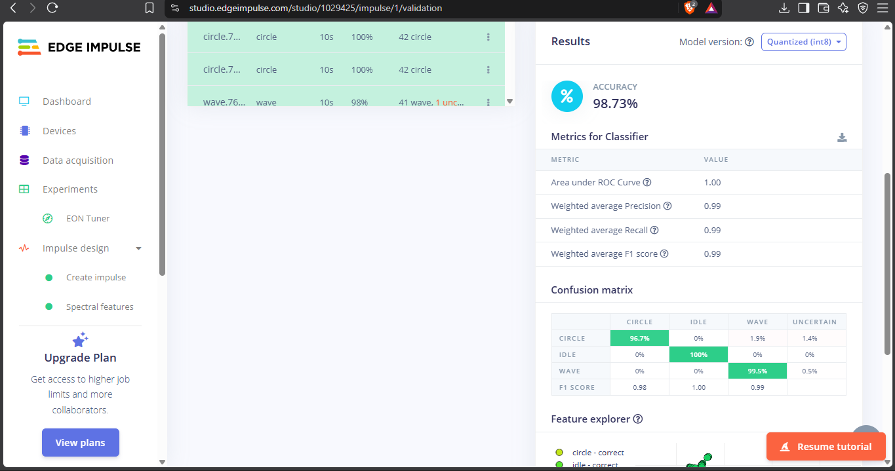

<h1 align="center">🎯 GestureHalo</h1>
 
<p align="center">
  Gesture recognition from a phone's accelerometer.<br>
  A small neural network trained in Edge Impulse runs <b>in the browser</b> as WebAssembly.
</p>
<p align="center">
  <a href="https://gesturehalo.web.app"></a>
</p>
<p align="center">
  
  
  
  
</p>
> **Prototype** trained on a small personal dataset: one person, one phone. It has not been tested on other people or other phones. Open the demo on a phone, because motion sensors need HTTPS.
 
---
 
## ✨ What it recognises
 
| Gesture | What to do |
|---------|------------|
| ✋ **idle** | Hold the phone still |
| 👋 **wave** | Wave it side to side |
| ⭕ **circle** | Draw circles in the air |
 
## 🧭 Pipeline
 
```
Phone accelerometer  →  2 s window  →  Spectral features  →  Neural network  →  idle / wave / circle
   62.5 Hz              125 × 3 axes     39 features          20 → 10 → 3 (int8)   runs in the browser
```
 
| Stage | Detail |
|-------|--------|
| Sensor | Phone accelerometer including gravity (`devicemotion`), resampled to 62.5 Hz |
| Window | 2 seconds (125 samples × 3 axes), a new prediction every 200 ms |
| Features | Edge Impulse Spectral Analysis (39 features) |
| Model | Small neural network: dense 20, dense 10, 3 outputs; quantized int8 |
| Runtime | Edge Impulse WebAssembly build, running in the browser |
| Hosting | Firebase Hosting |
 
The page shows the three class probabilities, a live accelerometer graph and a gesture log. A gesture is logged after 2 matching predictions in a row, and anything under 60% confidence is shown as "uncertain". The log can be exported as CSV. A "Flip axis signs" switch is there because iPhone and Android report axis signs differently.
 
## 📊 Result
 
Tested on **15 held-out recordings** (5 per gesture, about 630 two-second windows) that were never used for training:
 
| Metric | Value |
|--------|-------|
| Accuracy (per 2 s window, quantized int8 model) | **98.73%** |
| Idle | 100% |
| Wave | 99.5% (0.5% uncertain) |
| Circle | 96.7% (1.9% read as wave, 1.4% uncertain) |
 
<p align="center">
  
</p>
How to read this:
- Edge Impulse scores 2-second windows that overlap by 90%, so the windows are not independent. The honest sample size is the 15 recordings.
- "Uncertain" (below the confidence threshold) counts as a miss.
- The 100% validation accuracy shown during training is not reported as a result, because validation windows come from the same recordings as the training windows.
## 🗂️ Data
 
45 training recordings (10 s each, 62.5 Hz, accelerometer) plus 15 separate test recordings, all recorded by one person, hand-held, with the Edge Impulse mobile client.
 
## 🛠️ Development notes
 
A first model scored 85.98% on an initial test set of 9 recordings, mostly missing circle. I moved those recordings into training, added more varied circle, wave and idle recordings, retrained, and then recorded 15 new recordings for the final test above.
 
## ▶️ Run it
 
1. Open the [live demo](https://gesturehalo.web.app) on a phone and tap **Start Sensors**. Allow motion access if asked (iPhone: Settings → Safari → Motion & Orientation Access).
2. Hold the phone steady for idle, wave it side to side, or draw circles in the air.
3. If the axes look inverted (with the phone flat, face up, the Z line should sit near +9.8), toggle **Flip axis signs**.
To host your own copy: put the files in a Firebase Hosting project and run `firebase deploy --only hosting`.
 
## ⚠️ Limitations
 
- Trained and tested on one person and one phone.
- Only three gestures.
- Sensitive to how the phone is held and to axis conventions between devices.
- Accuracy above is per 2-second window on 15 recordings, not a general claim.
## 📁 Repository layout
 
```
public/            the web page (index.html)
public/model/      Edge Impulse WebAssembly export (run-impulse.js, edge-impulse-standalone.js/.wasm)
docs/              test result screenshot
firebase.json      Firebase Hosting config
```
 
The files in `public/model/` were generated by Edge Impulse Studio.
 
## 🕰️ History
 
GestureHalo was first built as the capstone of the Edge IoT & Smart Automation internship (IEEE SB GCEK with Usizo Solutions, June 2026). That first version used a placeholder heuristic. This version replaces it with a trained model.
 
---
 
<p align="center">
  Built by <b>Navaneeth G</b> ·
  <a href="https://www.linkedin.com/in/navaneeth-g-b1a735278">LinkedIn</a> ·
  <a href="https://navaneeth-f9362.web.app">Portfolio</a>
</p>
